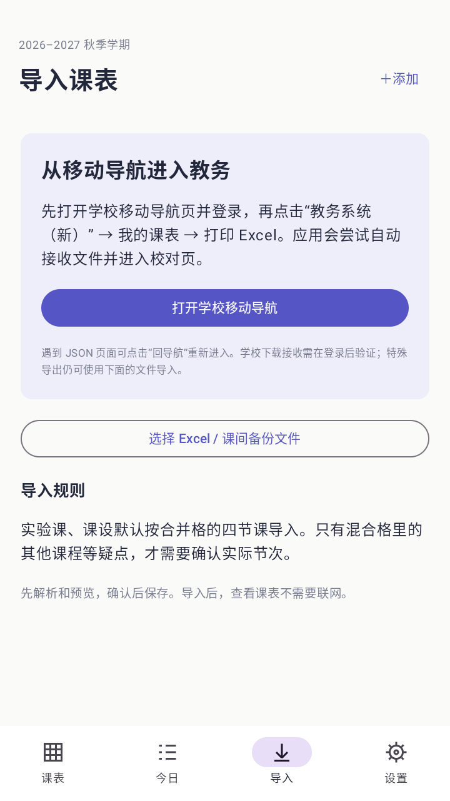
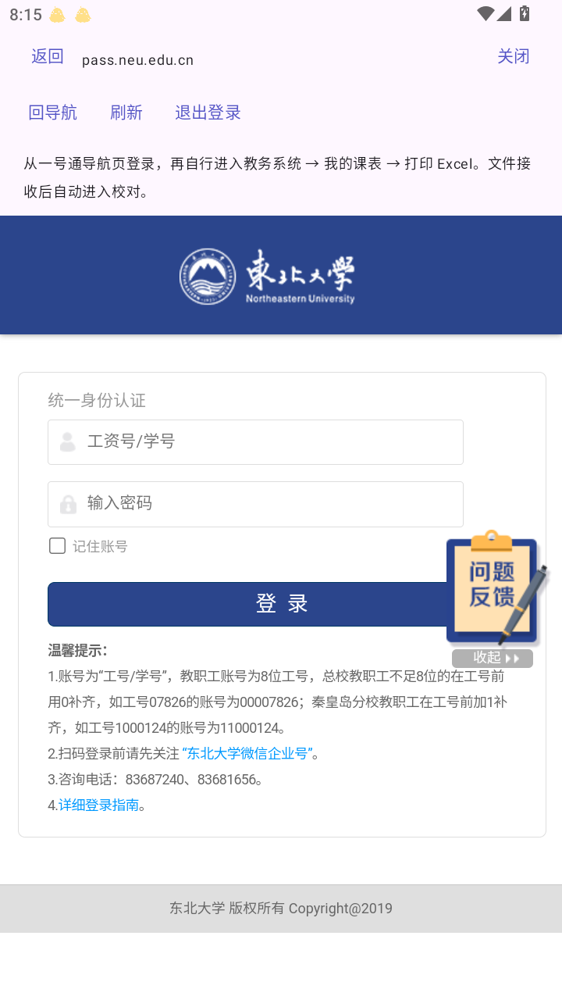
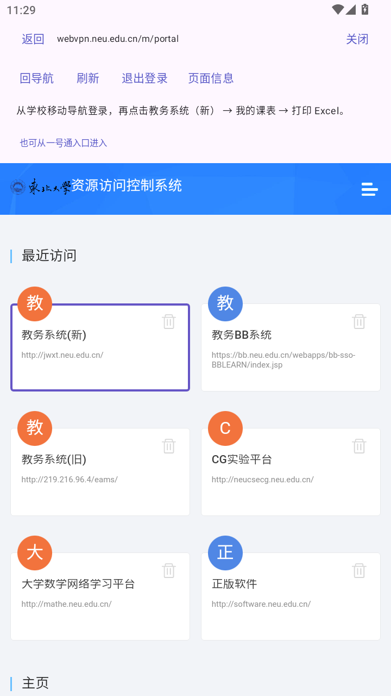
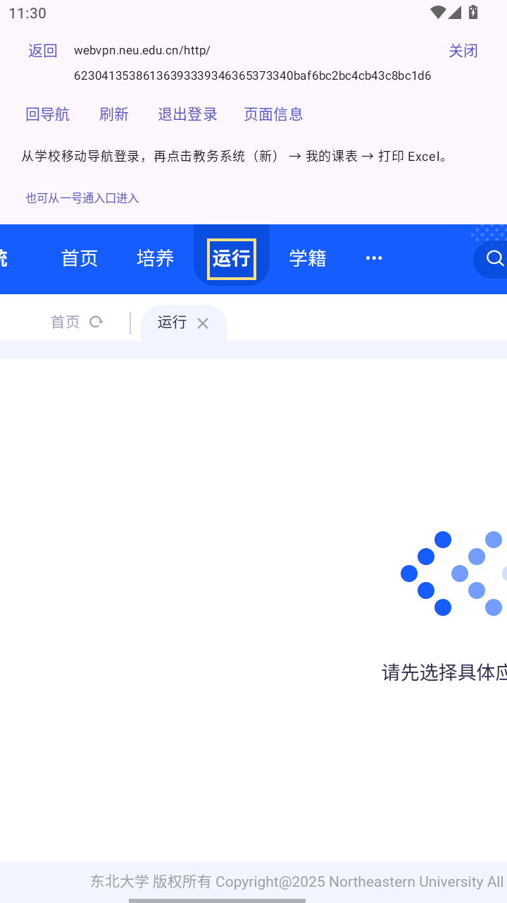
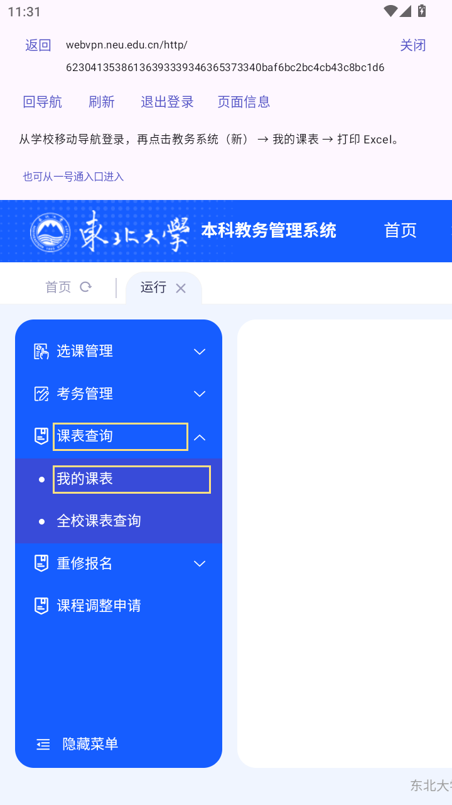
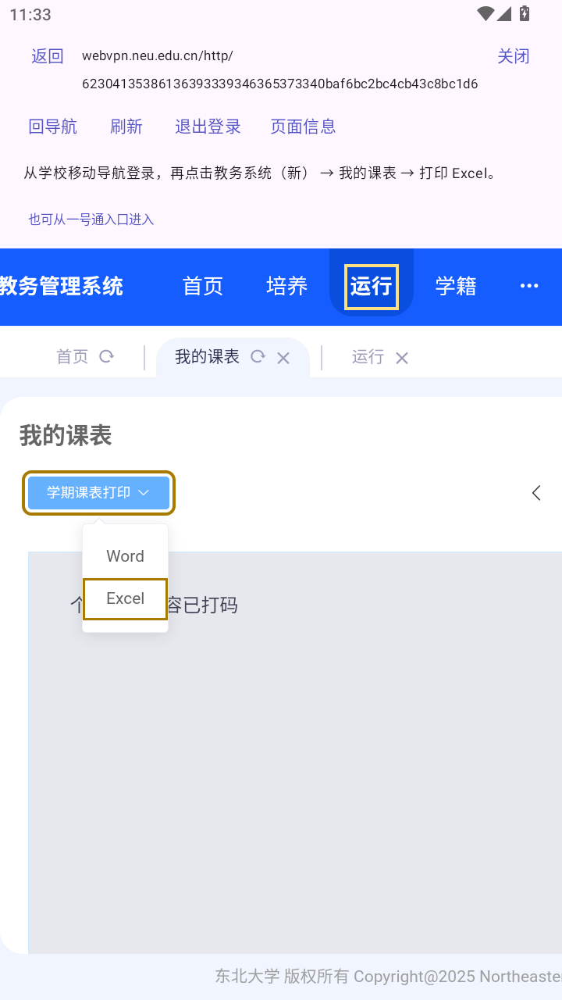
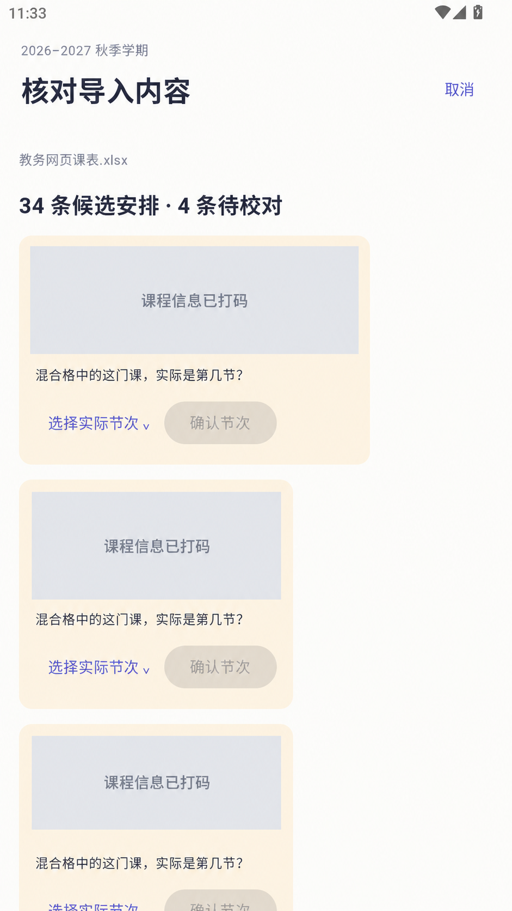
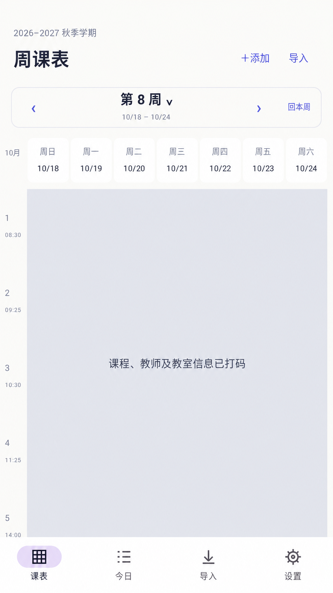
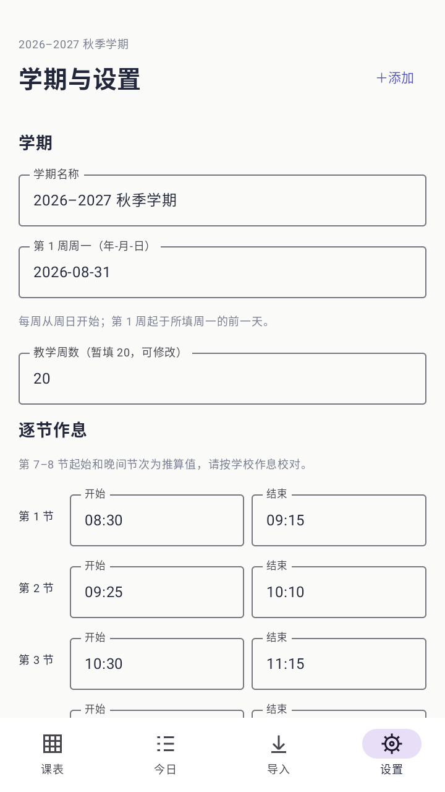

# 基于东北大学教务系统制作的手机课程表软件

**课间**是一款中文、无广告的 Android 课程表，针对东北大学教务系统的 Excel 导出格式开发。导入后可离线查看课程、教师和教室，无需注册额外的软件账号。

> 个人开发项目，与东北大学官方无隶属关系。当前为 **0.1.7 测试版**，最低支持 Android 8.0，不依赖 Google Play 服务。HarmonyOS 设备需要具备 Android APK 安装能力；纯鸿蒙系统不适用。

## 下载与安装

[下载最新 APK](https://github.com/mmma-eey/neu-timetable/releases/download/v0.1.7/kejian-0.1.7.apk) · [仓库内的 0.1.7 APK](releases/kejian-0.1.7.apk)

下载 APK 后在手机打开并安装。已装本项目旧测试版可覆盖安装，保留本机课表；更换签名时无法直接覆盖。首次安装如需授权，请仅对实际使用的下载来源开放安装权限。

本仓库仅保留最新版本 APK。测试版使用调试签名；从源码自行编译使用的是你自己的本机调试密钥，可能无法覆盖这里提供的安装包。

## 使用方法（截图）

应用主界面和本次学校操作截图来自实际运行的 0.1.7 应用；统一认证页使用此前拍摄的真实空白登录页，上方提示栏与新版略有不同。截图中的私人信息均已遮盖，操作入口加框以便定位。

### 1. 导入学校课表

打开底部 **导入** → **打开学校移动导航**，自行完成学校登录，依次进入 **教务系统（新） → 我的课表 → 打印 Excel**。

应用接收导出文件后进入校对页。请从导航逐步进入教务，直接登录具体功能地址可能落到 JSON 页面。默认使用校外 WebVPN 入口；连接校园网时若提示仅限校外访问，请用网页内的一号通入口进入校内系统。



也可以先在浏览器下载学校导出的 `.xlsx`，再点 **选择 Excel / 课间备份文件**。当前不支持把 Word 文件直接导入。

#### 第一步：在学校统一认证页登录

点击“打开学校移动导航”后，未登录时会跳转到学校统一身份认证页。在校方页面输入工资号／学号及密码，完成可能出现的验证码，点击 **登录**。不要把账号密码发到 Issue 或聊天中。若已有有效会话，会跳过这一步，直接显示下一步的资源导航。



#### 第二步：点击“教务系统（新）”

进入资源访问控制系统的导航后，找到 **教务系统（新）** 并点击。图中位于“最近访问”；首次访问不一定出现在此处，可向下查找同名入口。不要选择“教务系统（旧）”。



#### 第三步：打开顶部“运行”

教务首页上方点击 **运行**。学校网页宽于手机屏幕，顶部菜单不全时，可横向滑动网页找到它；图中为横向滑动后的位置。



#### 第四步：课表查询 → 我的课表

回到页面左侧，展开 **课表查询**，点击下方 **我的课表**。如果手机上只看到中间内容，可横向滑回左侧再操作。



#### 第五步：学期课表打印 → Excel

在“我的课表”页面确认是所需学期，然后点 **学期课表打印** 右侧的小箭头，从下拉菜单选择 **Excel**。不要选 Word。打印按钮或课表不在屏幕内时，可横向滑到内容区。



这里的“打印 Excel”实际会生成并下载 `.xlsx`。应用会接管这次导出、接收文件，并自动进入下一步。若先出现接收进度，等待完成即可，不需要去其他浏览器找下载。

#### 第六步：看到“核对导入内容”即已接收成功

页面显示“候选安排”和“待校对”数量，说明 Excel 已下载并解析。图中的 **34 条／4 条** 只是该次导出的结果，你的数量可能不同。继续校对实际节次，按后文说明选择合并或替换，确认后才会保存。



若下载失败，保持当前登录页面，先看“页面信息”的导出状态；也可在手机浏览器下载 Excel 后通过本地文件导入。遇到 JSON 页面，用 **回导航** 从导航入口重新进入。


### 2. 校对并保存

接收文件只会生成预览，**点击确认前不会写入课表**。

- 检查学期、周次、节次、教师和地点。
- 实验课、课设默认使用合并格跨度。跨四节或更多节、包含不同课程的混合格中，普通课程会标记为待校对，需要确认实际节次。
- 可仅导入已确认项，暂时跳过疑点。无法识别的原文会另行提示；没有疑点标记也建议和原表核对。
- 选择替换或合并，再确认保存。合并按完整安排去重，不只是按课程名。

### 3. 查看和切换周次

底部 **课表** 显示七天课程，顶部显示日期及当前周次。每周为 **周日到周六**，例如 2026 年第 8 教学周为 10 月 18 日至 24 日。

在课表区域 **左滑到下一周，右滑到上一周**，拖动时可预览相邻周。也可点周次直接选择，或点 **回本周**。上下滑动查看后面的节次；点击课程查看详情、编辑或删除。底部 **今日** 查看当天安排。



### 4. 设置学期与作息

打开底部 **设置**，填写学期名称、**第 1 周周一**、教学周数和每节课的起止时间，滚动到底部保存。

第一周周一填写 `2026-08-31` 时，该周从前一天 `2026-08-30` 周日开始。日期来自手机系统时间，按北京时间计算，无需联网查日期。第 7–8 节及晚间作息含推算值，请按本校实际安排校对；教学周数默认 20，可修改。



### 5. 备份和恢复

在 **设置 → 数据与隐私** 中导出本地 JSON 备份，或选择备份文件恢复。每次导入前保留一份课表快照，可恢复到上一次导入前。备份包含课程和地点等私人信息，请自行保管；换学期前建议先备份。

## 功能与适用范围

- 周课表、今日课程，教师与教室直接展示；左右滑动切周。
- 东北大学教务导出 Excel 的本地解析、周次及单双周、导入校对、冲突提示。
- 应用内登录并接收学校 Excel 导出；失败时可手动选择文件。
- 课程增删改、学期和逐节作息设置、本地备份与导入前快照。

当前管理一个学期。模板识别和网页导出适配主要面向东北大学，其他学校需要适配，不是通用 Excel 表格识别器。暂未实现 Word 导入、课前通知、桌面小组件、云同步或后台自动同步。

## 工程结构

```text
.
├── app/                   # Android 应用、资源、单元测试和 WebView 集成测试
│   └── src/main/java/cn/kejian/timetable/
│       ├── domain/        # 课程、学期、周次和校验规则
│       ├── data/          # Excel 解析、Room 数据库、备份
│       ├── ui/            # 状态管理
│       └── *.kt           # Compose 界面、学校 WebView 与导出接收
├── gradle/                # Gradle Wrapper
├── docs/                  # 使用截图、架构、开发及验证说明
├── releases/              # 仅最新可安装 APK 和校验值
├── scripts/               # 构建辅助脚本
├── README.md
└── .local/                # 本机私人资料与历史调试文件；Git 忽略，不上传
```

用 Android Studio 打开**本仓库根目录**。环境、构建和测试方法见 [开发说明](docs/DEVELOPMENT.md)，实现划分见 [架构说明](docs/ARCHITECTURE.md)，验证范围见 [验证记录](docs/VALIDATION.md)。

## 隐私说明

课程保存在本机；应用没有广告、统计 SDK 或自建账号服务器，不申请通讯录和整个存储空间权限。联网用于学校登录与下载，账号密码由校方网页处理。可在学校网页退出登录，清除 WebView 会话。

公开仓库不包含个人课表原件、HAR、Cookie、登录令牌、数据库、签名密钥和未打码的私人截图。APK 不预装个人课程。请不要在 Issue 中上传含密码、Cookie 或登录会话的抓包；反馈问题时先脱敏。


## 开源协议

本项目原创代码采用 [MIT License](LICENSE)，允许使用、修改和分发，包括商业使用；分发时须保留版权与许可声明。软件按现状提供。

第三方依赖、Gradle Wrapper 及截图中的学校网页、名称和标识不因本项目而改变其原有许可或权利归属。
